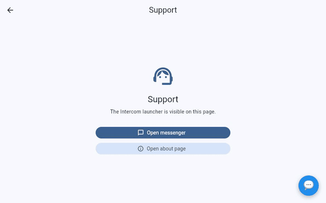

# Flutter Web Intercom Sample

Show the Intercom chat launcher on specific pages of a Flutter web app, and hide it everywhere else.



_The demo uses a mock launcher in place of the real Intercom widget._

> **Note:**
> The [original article](https://sharmadhiraj.medium.com/integrate-intercom-on-flutter-web-and-show-only-on-specific-pages-2bb312d46a97)
> is outdated. The code has since been reworked and no longer matches it. Follow this README and the
> source instead.

## How it works

1. `web/index.html` loads the Intercom widget with the default launcher hidden and exposes two JS
   functions: `setIntercomLauncherVisible` and `openIntercomMessenger`.
2. `lib/intercom/` calls them from Dart through `dart:js_interop`. On non-web platforms a no-op stub
   is used, so the same code runs everywhere.
3. `IntercomScope` wraps a page and shows the launcher only while that page is visible.

```
IntercomScope(
  child: MyPage(),
)
```

## Setup

1. Set your app ID in `web/index.html`:
   ```js
   var APP_ID = "YOUR_INTERCOM_APP_ID";
   ```
2. Run it:
   ```sh
   flutter run -d chrome
   ```

## Structure

```
lib/
  app.dart                 IntercomSampleApp: theme and root widget
  intercom/                Launcher bridge (web + stub) and IntercomScope
  screens/                 Home, Support (Intercom), About
  widgets/                 Shared UI: DemoPage, ActionButton
web/index.html             Intercom snippet
```
